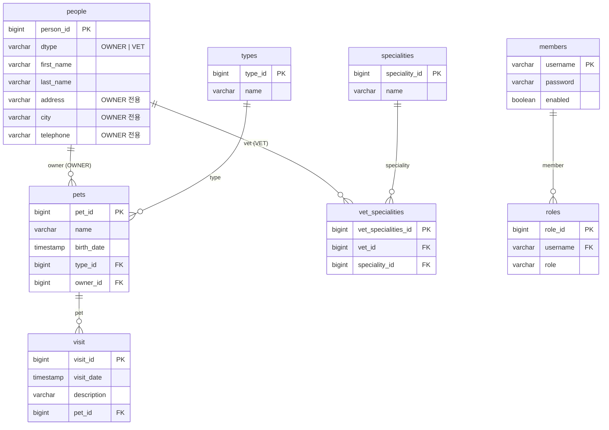

# CLAUDE.md

Spring Boot + JPA 기반 PetClinic REST API 샘플 프로젝트입니다. 현재는 **조회(GET) 전용** API만 구현되어 있습니다.

## 기술 스택

- Java 17 (Gradle toolchain), Gradle Kotlin DSL (`build.gradle.kts`)
- Spring Boot 4.1.1, Spring Data JPA, Spring Web MVC, Thymeleaf
- H2 in-memory DB (runtime), H2 Console / DevTools (developmentOnly)
- springdoc-openapi 3.1.1 (Swagger UI)
- 테스트: JUnit 5, spring-boot-starter-webmvc-test
- `src/main/resources/application.yml`은 현재 비어 있음 (모두 기본 설정)

## DB / 영속성

- **DB: 내장 메모리 H2 DB 적용.** 외부 DB 없음. 앱 기동 시 `jdbc:h2:mem:<random-uuid>`로 생성되고 종료 시 사라짐.
- 스키마는 Hibernate `ddl-auto` 기본값(`create-drop`)으로 엔티티에서 자동 생성. 별도 `schema.sql`/`data.sql` 없음.
- 데이터는 `LoadDatabase`의 `CommandLineRunner`가 기동 때마다 적재.
- **Repository: Spring Data JPA 사용.** 모든 Repository는 `JpaRepository<Entity, ID>`를 상속하는 인터페이스이며 커스텀 쿼리 메서드나 `@Query`는 없음.
- H2 Console 접속 시 JDBC URL은 기동 로그의 `HikariPool-1 - Added connection` 줄에서 확인 (username `sa`, 비밀번호 없음).

## 빌드 / 실행

```bash
./gradlew bootRun          # 앱 실행 (기본 포트 8080)
./gradlew test             # 테스트 (contextLoads + OwnerControllerTest MockMvc 4건)
./gradlew build
```

- Swagger UI: `http://localhost:8080/swagger-ui.html`
- H2 Console: `http://localhost:8080/h2-console`

## 프로젝트 구조

JPA를 활용한 기본 4계층 구조입니다. 새 도메인을 추가할 때도 이 4개 패키지를 모두 갖춥니다.

| 계층 | 패키지 | 역할 |
|---|---|---|
| entity | `entity/` | JPA 엔티티 (`@Entity`), 테이블 매핑 |
| repository | `repository/` | Spring Data JPA `JpaRepository` 인터페이스 |
| service | `service/` | 비즈니스 로직, `@Transactional` 경계 |
| controller | `controller/` | REST 엔드포인트, Entity → DTO 변환 (`controller/response/`) |

```
src/main/java/com/example/petclinic/
├── PetclinicApplication.java      # @SpringBootApplication 진입점
├── LoadDatabase.java              # CommandLineRunner로 기동 시 샘플 데이터 적재
├── controller/                    # @RestController, /api/v1/** 엔드포인트
│   ├── MemberController, OwnerController, PetController, PetTypeController,
│   ├── SpecialityController, VetController, VisitController
│   └── response/                  # 응답 DTO (XxxDto, 기본 생성자 + 전체 생성자 + getter/setter)
├── service/                       # @Service @Transactional(readOnly = true)
│   └── XxxService: findXxxs(), findXxx(id) — 없으면 NoSuchElementException
├── repository/                    # JpaRepository<Entity, ID> 인터페이스 (커스텀 쿼리 없음)
└── entity/                        # JPA 엔티티 (Lombok 미사용, 수동 getter/setter)
src/main/resources/application.yml # 비어 있음
src/test/java/.../PetclinicApplicationTests.java
```

## 계층 흐름

`Controller → Service → Repository → Entity`

- Controller가 Entity를 받아 직접 DTO로 변환합니다 (별도 Mapper 없음).
- 연관 엔티티는 모두 `FetchType.LAZY`이며, 컨트롤러에서 getter로 접근해 DTO에 중첩합니다 (예: PetDto 안에 PetTypeDto, OwnerDto).
- Service는 읽기 전용 트랜잭션만 존재하며, 생성/수정/삭제 로직은 아직 없습니다.

## 도메인 용어 (ER 다이어그램 기준)

| 테이블 | 의미 |
|---|---|
| vets | 수의사 |
| specialties | 전공 (수의사의 전문 분야) |
| owners | pet 오너 |
| pets | pet |
| types | pet 타입 (개, 고양이, 새 등) |
| visits | 수의사에게 방문한 기록 |

> 코드의 실제 테이블명은 아래 ER 다이어그램과 같이 일부 다릅니다 (`specialities`, `visit`, vets/owners는 `people` 단일 테이블).

## ER 다이어그램 (코드 기준)



## 엔티티 / 테이블 매핑

| 엔티티 | 테이블 | 비고 |
|---|---|---|
| Person | `people` | SINGLE_TABLE 상속, 판별 컬럼 `dtype`, `person_id`, first/last name |
| Owner | `people` (`dtype=OWNER`) | Person 상속. address, city, telephone |
| Vet | `people` (`dtype=VET`) | Person 상속 |
| Speciality | `specialities` | `speciality_id`, name |
| VetSpeciality | `vet_specialities` | Vet ↔ Speciality N:M 연결 테이블 (ManyToOne 둘 다) |
| PetType | `types` | `type_id`, name |
| Pet | `pets` | `pet_id`, name, birth_date(LocalDateTime), ManyToOne type/owner |
| Visit | `visit` | `visit_id`, ManyToOne pet, visit_date(LocalDateTime), description |
| Member | `members` | PK `username`(String), password, enabled |
| Role | `roles` | `role_id`, ManyToOne member(FK username), role(ROLE_ADMIN 등) |

- 모든 연관은 자식 쪽 `@ManyToOne(LAZY)` 단방향입니다. 부모 쪽 `@OneToMany` 컬렉션은 없습니다.

## REST 엔드포인트 (모두 GET)

| Base path | 목록 | 단건 |
|---|---|---|
| `/api/v1/owners` | `GET`, `GET ?lastname=kim` (lastName이 kim으로 시작, 대소문자 무시) | `GET /{id}` |
| `/api/v1/pets` | `GET` | `GET /{id}` |
| `/api/v1/types` | `GET` | `GET /{id}` |
| `/api/v1/vets` | `GET` | `GET /{id}` |
| `/api/v1/specialities` | `GET` | `GET /{id}` |
| `/api/v1/visits` | `GET` | `GET /{id}` |
| `/api/v1/members` | `GET` | `GET /{username}` |

## LoadDatabase (더미 데이터)

`LoadDatabase.java`는 더미 데이터 세팅을 위한 `@Configuration` 클래스입니다. `CommandLineRunner` 빈을 등록해 **서버 동작 시 저장되며, 서버 종료 후 소멸**합니다 (내장 메모리 H2 DB이므로 재기동 때마다 새로 적재).

- 적재 방식: 엔티티를 `new`로 만들고 setter로 값을 채운 뒤 각 Repository의 `save()` 호출. SQL 스크립트 없음.
- 적재 순서: Vet → Speciality → VetSpeciality → PetType → Owner → Pet → Visit → Member → Role (FK 대상이 먼저 저장되도록 순서 유지 필요).
- 적재 건수: Vet 6, Speciality 3, VetSpeciality 5, PetType 6, Owner 10, Pet 13, Visit 4, Member 1(`admin` / `{noop}admin`), Role 3. 원본 Spring PetClinic 샘플 데이터와 동일.
- 날짜 필드는 `LocalDate.parse("yyyy-MM-dd").atStartOfDay()`로 `LocalDateTime`에 넣습니다.
- 더미 데이터를 바꾸려면 이 파일만 수정하면 됩니다. ID는 IDENTITY 전략이라 저장 순서대로 1부터 부여됩니다.

## 컨벤션 / 주의사항

- Lombok을 쓰지 않습니다. 엔티티/DTO에 getter/setter를 직접 작성합니다.
- 새 도메인 추가 시 `entity → repository → service → controller/response DTO → controller` 순으로 동일한 패턴을 따릅니다.
- **테이블은 명세(ER 다이어그램)에 맞춰 엔티티로 구현**합니다. 테이블명은 `@Table(name=...)`, PK 컬럼명은 `@Column(name="xxx_id")`로 명시합니다.
- **1:N 관계는 N쪽 엔티티에 `@ManyToOne(fetch = FetchType.LAZY)` + `@JoinColumn`으로 구현**합니다. 1쪽에 `@OneToMany` 컬렉션을 두지 않는 단방향이 기본입니다. (예: `Pet.owner`, `Pet.type`, `Visit.pet`, `Role.member`)
- N:M 관계는 별도 연결 엔티티로 풀어서 양쪽에 `@ManyToOne`을 둡니다. (예: `VetSpeciality`)
- **Repository는 Spring Data JPA를 활용하며 `JpaRepository<Entity, ID>` 인터페이스를 그대로 사용**합니다. 기본 제공 메서드(`findAll`, `findById`, `save` 등)를 우선 쓰고, 조건 조회가 필요하면 `@Query` 대신 Spring Data **메서드 이름 파생 쿼리**를 추가합니다 (예: `OwnerRepository.findByLastNameStartingWithIgnoreCase`). 구현 클래스는 두지 않습니다.
- 목록 필터 파라미터는 `@RequestParam(required = false)`로 받고, Service에서 null/공백이면 전체 조회로 처리합니다 (예: `OwnerService.findOwnersByLastName`).
- **Service는 전체 조회와 단일 조회를 구현**합니다. 클래스에 `@Service @Transactional(readOnly = true)`를 붙이고 Repository를 생성자 주입합니다.
  - 전체 조회: `findXxxs()` → `repository.findAll()`
  - 단일 조회: `findXxx(id)` → private `verifyXxxExists(id)`가 `findById(id).orElseThrow(() -> new NoSuchElementException("Xxx does not exist"))`로 **예외처리** (존재하지 않으면 `NoSuchElementException`)
- **Controller는 전체 조회와 단일 조회를 구현**합니다. `@RestController @RequestMapping("/api/v1/<복수형>")`, Service를 생성자 주입합니다.
  - 전체 조회: `@GetMapping list()` → `List<XxxDto>`
  - 단일 조회: `@GetMapping("/{id}") detail(@PathVariable Long id)` → `XxxDto`
- **각각의 request에 대한 response DTO를 `controller/response/XxxDto`로 구현**합니다. DTO(Data Transfer Object)는 요청과 응답에 적절한 데이터 타입을 만든 클래스입니다.
  - 엔티티를 API 응답으로 직접 노출하지 않고, Controller에서 Entity → DTO로 변환해 반환합니다 (별도 Mapper 없음).
  - DTO는 기본 생성자 + 전체 필드 생성자 + getter/setter로 작성합니다.
  - 연관 객체는 중첩 DTO로 담습니다 (예: `PetDto` 안에 `PetTypeDto`, `OwnerDto`; `VisitDto` 안에 `PetDto`).
- Owner/Vet은 `people` 단일 테이블을 공유하므로 ID가 섞여 부여됩니다. 더미 데이터 기준 Vet은 1~6, Owner는 7~16입니다.
- 전역 예외 처리(`@ControllerAdvice`)가 없어 `NoSuchElementException`은 500으로 응답됩니다.
- Spring Security는 의존성에 없습니다. Member/Role 엔티티는 데이터만 존재합니다.
- 루트의 `Day3_petclinic_r2.zip`은 원본 소스 압축본이며 git에서 제외되어 있습니다.
